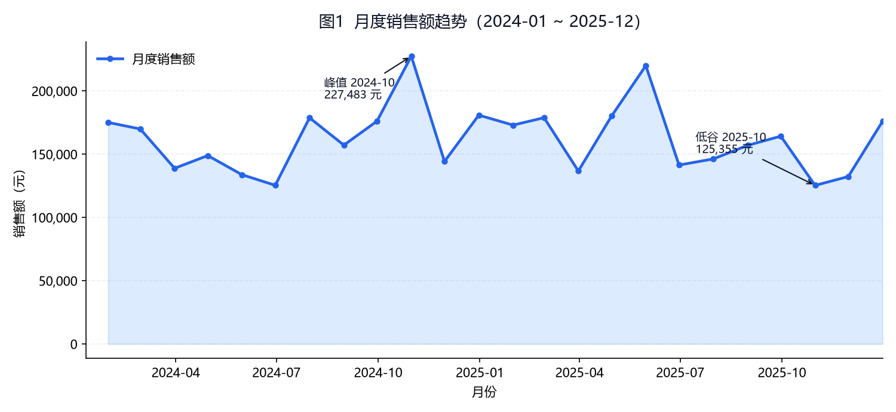
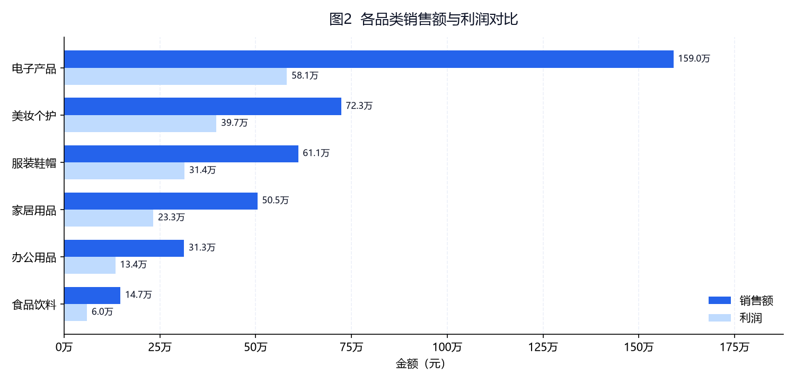
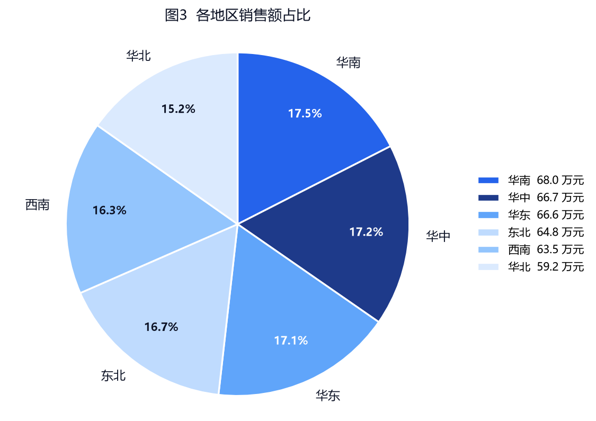
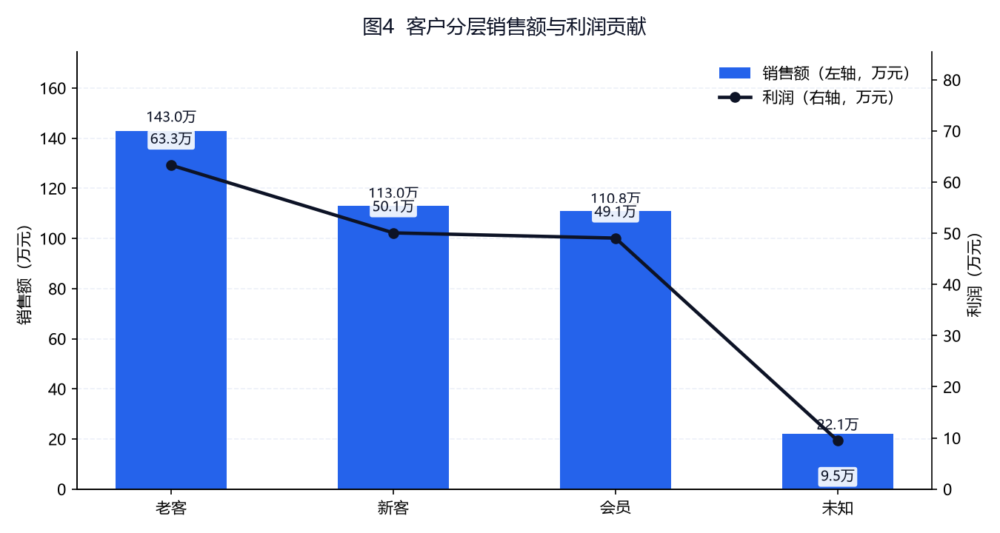

# 2024—2025 区域零售销售数据分析报告

> **报告名称**：区域连锁零售经营分析报告（管理层版）
> **数据时间范围**：2024-01-01 ~ 2025-12-31
> **数据来源**：`data/retail_sales_raw.csv`（原始订单 3654 行，合成教学数据），经多智能体流水线清洗后有效订单 3388 笔
> **口径文件**：本报告全部数字引自 `outputs/summary_metrics.json`（唯一数字口径），该文件已通过质检（`outputs/qa_review.md`，结论：有条件通过）
> **生成日期**：2026-11-05 ｜ **流水线运行编号**：R001
> **编制**：Reporter（报告撰写智能体）｜ 数据工程：Data Engineer ｜ 分析：Analyst ｜ 质检：Reviewer ｜ 统筹：Orchestrator

---

## 一、执行摘要

1. **整体经营规模**：2024—2025 两年累计有效订单 **3,388 笔**，总销售额 **3,888,210.60 元**（388.82 万元），总利润 **1,719,269.64 元**（171.93 万元），整体利润率 **44.22%**，客单价 **1,147.64 元**。
2. **规模集中于电子产品，盈利质量最高的是美妆个护**：电子产品销售额 **159.03 万元**、占总销售额 **40.90%**，为第一大品类，但其利润率 **36.56%** 低于整体水平；美妆个护利润率 **54.98%** 为六品类最高，销售额占比 **18.59%**。**规模第一与盈利质量第一不是同一个品类**，这是本报告最重要的一项结构判断。
3. **地区分布高度均衡**：华南、华中、华东销售额位列前三，分别占 **17.49% / 17.16% / 17.13%**；六大区利润率集中在 **43.58%–44.97%** 的窄区间内（极差 1.39 个百分点），**没有明显的高地或洼地**。这一结论意味着按大区做差异化资源投放的收益空间有限。
4. **客户分层贡献差距不大，但存在 4.8% 的标签盲区**：老客贡献销售额 **36.77%**、新客 **29.05%**、会员 **28.50%**；另有 **163 笔订单（占 4.81%）** 客户分层为「未知」，其利润率 **42.93%** 略低于整体，但因样本占比不足 5%，**不构成任何经营结论**，只能作为数据治理问题处理。
5. **两年经营基本持平，月度波动明显大于年度变化**：2024 年销售额 **195.68 万元**、2025 年 **193.14 万元**，同比 **−1.30%**；而月度销售额在 **125,354.79 元（2025-10）** 至 **227,482.51 元（2024-10）** 之间波动，单月极差达 **10.21 万元**（约 81.5%）。

**建议方向**（详见第九节）：把资源从「拓地区」转向「提品类结构」——在电子产品守住规模的同时，提升美妆个护与服装鞋帽的销售占比；同时优先补齐 4.8% 的客户标签盲区，为后续分层运营建立数据基础。

---

## 二、整体经营概况

### 2.1 总体指标

| 指标 | 数值 | 计算口径 |
|---|---|---|
| 有效订单数 | 3,388 笔 | 清洗后记录行数 |
| 总销售额 | 3,888,210.60 元 | `sales_amount` 求和，口径为 `quantity × unit_price × (1 − discount)` |
| 总利润 | 1,719,269.64 元 | `profit` 求和（原始成本口径） |
| 整体利润率 | 44.22% | 总利润 ÷ 总销售额 |
| 客单价 | 1,147.64 元 | 总销售额 ÷ 有效订单数 |
| 件单价均值 | 285.35 元 | `unit_price` 算术平均（非加权） |
| 平均购买件数 | 4.48 件/单 | `quantity` 算术平均 |
| 平均折扣率 | 10.04% | `discount` 算术平均 |
| 时间范围 | 2024-01-01 ~ 2025-12-31 | 清洗后订单日期的最小值与最大值 |

### 2.2 数据基础说明

原始订单 3654 行经清洗后保留 3388 行，剔除比例 **7.28%**。剔除构成如下（详见 `outputs/cleaning_report.json`）：

| 处理项 | 条数 | 处理规则 |
|---|---|---|
| 原始记录 | 3,654 | — |
| 日期缺失剔除 | 72 | 下单日期为空，无法归属月度趋势 |
| 日期不可解析剔除 | 0 | 统一 `YYYY/MM/DD` 与 `YYYY-MM-DD` 后无残留 |
| 整行去重 | 54 | 15 字段完全一致的重复录入，保留首次出现 |
| 异常数量剔除 | 35 | `quantity ≤ 0` 的录入错误 |
| 负利润剔除 | 105 | `profit < 0` 的折扣 / 成本录入异常订单 |
| 客户分层缺失回填 | 163 | 回填为「未知」，保留记录不剔除 |
| **清洗后有效订单** | **3,388** | **剔除比例 7.28%** |

> 口径提醒：客户分层原始缺失 182 条，其中 19 条随上述脏记录一并剔除，剩余 163 条回填为「未知」。因此「回填 163」小于「原始缺失 182」并非统计错误，而是清洗顺序导致的必然结果。

---

## 三、趋势分析

### 3.1 月度销售额趋势



| 项目 | 月份 | 销售额（元） |
|---|---|---|
| **峰值** | 2024-10 | 227,482.51 |
| **低谷** | 2025-10 | 125,354.79 |
| 24 个月均值 | — | 162,008.78（388.82 万元 ÷ 24 个月） |

**数据事实**：
- 24 个月中，销售额高于 20 万元的月份有 **2 个**（2024-10 `227,482.51` 元；2025-05 `220,000.60` 元）。
- 销售额低于 13 万元的月份有 **2 个**（2025-10 `125,354.79` 元；2024-06 `125,454.31` 元）。
- 2024-10 与 2025-10 同为 10 月，但销售额相差 **102,127.72 元**（约为 2025-10 的 81.5%），说明**同一月份在两个年度之间并不可比**。

**分析判断**：月度序列呈现「高—低交替、无持续单向趋势」的特征，两年整体规模持平（见 3.2）。由于数据中不含促销、节假日、天气等外生字段，**峰值与低谷的成因无法从现有数据判断**，本报告不对 2024-10 的高点与 2025-10 的低点做任何原因解释——任何关于「大促」「季节性」的说法都属待验证假设，需补充活动日历字段后另行分析。

### 3.2 年度对比

| 年度 | 销售额（元） | 折合万元 | 同比 |
|---|---|---|---|
| 2024 | 1,956,839.15 | 195.68 | — |
| 2025 | 1,931,371.45 | 193.14 | **−1.30%** |

**分析判断**：两年销售额差异仅 25,467.70 元，属基本持平。在订单结构未发生明显变化的前提下，这一量级的差异不足以支撑「增长放缓」或「经营下滑」的定性结论。

---

## 四、品类分析

### 4.1 品类销售额与利润



| 排名 | 品类 | 销售额（元） | 销售额占比 | 利润（元） | 利润率 |
|---|---|---|---|---|---|
| 1 | 电子产品 | 1,590,277.86 | **40.90%** | 581,423.57 | 36.56% |
| 2 | 美妆个护 | 722,924.65 | 18.59% | 397,462.75 | **54.98%** |
| 3 | 服装鞋帽 | 610,761.72 | 15.71% | 314,199.98 | 51.44% |
| 4 | 家居用品 | 504,506.27 | 12.98% | 232,845.72 | 46.15% |
| 5 | 办公用品 | 312,842.31 | 8.05% | 133,820.51 | 42.78% |
| 6 | 食品饮料 | 146,897.79 | 3.78% | 59,517.11 | 40.52% |
| — | **合计** | **3,888,210.60** | **100.00%** | **1,719,269.64** | **44.22%** |

### 4.2 结构与判断

**数据事实**：
- 电子产品以 **40.90%** 的销售额占比成为第一大品类，规模约为第二名美妆个护的 **2.20 倍**。
- 利润率与规模呈**反向**关系：规模最大的电子产品利润率 **36.56%**，比规模第二的美妆个护（**54.98%**）低 **18.42 个百分点**，也是六品类中**唯一低于整体利润率（44.22%）**的品类。
- 食品饮料规模最小（**3.78%**，14.69 万元），利润率 **40.52%**，同样低于整体。

**分析判断**：
1. 电子产品撑起了四成营收，但其单位销售额的盈利效率最低。若电子产品的成本结构（本次数据中 `cost` 字段未拆分供货成本与物流成本）保持现状，则**营收增长依靠电子产品时，利润率会被稀释**——这是结构性判断，不需要额外的因果假设。
2. 美妆个护、服装鞋帽、家居用品三个品类利润率均高于整体（54.98% / 51.44% / 46.15%），合计销售额占比 **47.28%**，接近一半，是提升整体利润率的现实抓手。
3. **本报告不对「为什么电子产品利润率低」做归因**（如品牌溢价、渠道费用、促销力度），这些需要成本明细与促销记录才能判断。

---

## 五、地区分析

### 5.1 地区销售额占比



| 排名 | 大区 | 销售额（元） | 销售额占比 | 订单数 | 利润（元） | 利润率 |
|---|---|---|---|---|---|---|
| 1 | 华南 | 680,040.38 | 17.49% | 589 | 300,896.03 | 44.25% |
| 2 | 华中 | 667,246.03 | 17.16% | 574 | 295,290.24 | 44.26% |
| 3 | 华东 | 666,043.42 | 17.13% | 565 | 294,027.49 | 44.15% |
| 4 | 东北 | 647,548.69 | 16.65% | 546 | 282,193.69 | 43.58% |
| 5 | 西南 | 635,345.82 | 16.34% | 573 | 285,689.02 | 44.97% |
| 6 | 华北 | 591,986.26 | 15.23% | 541 | 261,173.17 | 44.12% |
| — | **合计** | **3,888,210.60** | **100.00%** | **3,388** | **1,719,269.64** | **44.22%** |

### 5.2 判断

**数据事实**：
- 第一名华南（17.49%）与第六名华北（15.23%）的销售额占比只差 **2.26 个百分点**，绝对额差 **88,054.12 元**。
- 利润率最高为西南 **44.97%**、最低为东北 **43.58%**，极差仅 **1.39 个百分点**，全部落在整体利润率 44.22% 的 ±0.8 个百分点内。

**分析判断**：六大区在规模与盈利效率上**都高度均衡**，不存在需要紧急干预的弱势区域。这一结构与「区域连锁、门店能力标准化」的经营形态相符。**对企业而言，这意味着按大区做差异化投放的边际收益有限**；资源分配的判断依据应更多落在品类与客户结构上，而不是地区上。

---

## 六、客户分层分析

### 6.1 分层贡献



| 客户分层 | 订单数 | 订单占比 | 销售额（元） | 销售额占比 | 利润（元） | 利润率 |
|---|---|---|---|---|---|---|
| 老客 | 1,281 | 37.81% | 1,429,699.65 | **36.77%** | 633,101.07 | 44.28% |
| 新客 | 996 | 29.40% | 1,129,642.36 | 29.05% | 500,843.66 | 44.34% |
| 会员 | 948 | 27.98% | 1,108,248.24 | 28.50% | 490,608.84 | 44.27% |
| 未知 | 163 | 4.81% | 220,620.35 | 5.67% | 94,716.07 | 42.93% |
| **合计** | **3,388** | **100.00%** | **3,888,210.60** | **100.00%** | **1,719,269.64** | **44.22%** |

### 6.2 判断

**数据事实**：
- 老客贡献销售额 **36.77%**，为最大分层；新客 **29.05%**、会员 **28.50%**，三者差距在 **8.27 个百分点**以内。
- 三个已知分层的利润率几乎一致（**44.27%–44.34%**），极差不足 0.1 个百分点。
- 「未知」分层 163 笔，销售额占比 **5.67%**，利润率 **42.93%**，比整体低 **1.29 个百分点**。

**分析判断**：
1. 三个已知分层在利润率上**几乎没有差异**，说明当前数据中不同客户类型购买的商品结构相近。**不能**据此得出「会员更值钱」或「老客更忠诚」的结论——本数据没有复购频次、留存时长等字段，无法支撑忠诚度判断。
2. 老客的订单占比（**37.81%**）高于其销售额占比（**36.77%**），对应客单价约 **1,116.08 元**，略低于整体客单价 1,147.64 元；新客、会员的销售额占比与订单占比基本持平（29.05% / 29.40%、28.50% / 27.98%）。整体看，**分层贡献呈「三七开」的均衡分布，而非「二八法则」**——这是一个与常见零售认知不同的事实，值得业务方复核数据采集范围是否已覆盖全部销售渠道。
3. 「未知」分层的 163 笔**不构成经营结论**（样本占比 4.81%），仅作为数据治理事项记录。

---

## 七、问题与风险

### 7.1 来自数据本身的问题

| # | 问题 | 数据依据 | 影响 |
|---|---|---|---|
| 1 | 电子产品一家独大且利润率偏低 | 销售额占比 40.90%，利润率 36.56%（六品类唯一低于整体） | 营收结构对单一品类依赖度高，营收增长会稀释利润率 |
| 2 | 食品饮料规模过小 | 销售额占比 3.78%（14.69 万元），利润率 40.52% | 该品类是否保留、是否调整货架与选品，需单独立项测算 |
| 3 | 客户标签存在 4.81% 盲区 | 「未知」分层 163 笔 | 分层运营的覆盖不完整，无法对这部分客户做定向动作 |
| 4 | 月度波动幅度远大于年度变化 | 单月极差 102,127.72 元（125,354.79 ~ 227,482.51） | 备货、人力排班的月度计划比年度计划更重要 |

### 7.2 来自数据口径与质量的遗留风险（引自质检报告）

| # | 风险 | 来源 | 建议处置 |
|---|---|---|---|
| 5 | 163 条「未知」分层客户标签缺失，19 条分层信息随脏记录一并剔除且不可恢复 | 质检 A2 / 遗留风险 1、2 | 从会员 / CRM 系统回补标签后重跑分层分析 |
| 6 | 13 条销售额原值与公式不符（原始全量 49 条），已按 `q×p×(1−d)` 覆盖，但**原值未留存** | 质检 D12b（建议级） | 下一版清洗脚本输出 `sales_recalc_diff.csv` 留痕 |
| 7 | 峰值与低谷**缺少可归因字段**（无促销、活动、天气等标记） | 质检 D15（提示） | 引入促销日历字段后做二次分析，本报告不做原因推断 |

---

## 八、行动建议

> 每条建议对应前文一条数据发现，并明确区分「可立即验证的假设」与「需要进一步数据支持的方向」。

| # | 对应发现 | 建议动作 | 性质 |
|---|---|---|---|
| 1 | 电子产品占比 40.90%、利润率 36.56% | 对电子产品做一次**单品级利润率盘点**（现有数据只有品类级 `profit`，需下钻到 `sub_category` 与单品），确认是少数爆款拉低利润率，还是整体成本结构问题 | 可立即验证的假设 |
| 2 | 美妆个护 / 服装鞋帽 / 家居用品合计占 47.28%、利润率均高于整体 | 在**不削减电子产品货位**的前提下，测试把端架与推荐位向高利润率品类倾斜，观察 1—2 个月的品类结构变化 | 可立即验证的假设 |
| 3 | 地区利润率极差仅 1.39 个百分点 | **暂缓**按大区做差异化促销预算，把预算判断依据改为品类与客户结构 | 可立即验证的假设 |
| 4 | 「未知」分层 163 笔（4.81%） | 优先补齐这 163 笔订单的客户标签（可从会员储值、手机号回溯），补齐后重跑分层分析，再判断分层运营是否值得投入 | 需要进一步数据支持 |
| 5 | 月度极差 102,127.72 元 | 建立月度滚动预测与备货机制；**先补数据**——接入促销日历、节假日、门店开业等外生字段，再判断波动是否可预测 | 需要进一步数据支持 |
| 6 | 三个已知分层利润率差异 < 0.1 个百分点 | **暂不启动**基于客户分层的差异化定价或权益设计——当前数据无法区分各分层的真实价值差异 | 需要进一步数据支持 |

---

## 九、附录

### 9.1 数据口径

| 项目 | 说明 |
|---|---|
| 销售额 | `sales_amount = quantity × unit_price × (1 − discount)`，四舍五入保留 2 位 |
| 利润 | `profit` 原始成本口径，清洗时未改写 |
| 利润率 | 利润 ÷ 销售额，保留 4 位小数（展示为 2 位百分比） |
| 客单价 | 总销售额 ÷ 有效订单数 |
| 件单价均值 | `unit_price` 算术平均，非销售额加权 |
| 月度 | 按 `order_date` 月末重采样求和 |
| 金额单位 | 元，保留 2 位小数；万元为元的换算值，保留 2 位 |
| 统计范围 | 2024-01-01 ~ 2025-12-31，有效订单 3,388 笔 |

### 9.2 字段说明

| 字段 | 含义 | 备注 |
|---|---|---|
| order_id | 订单编号 | 重复录入时整行重复 |
| order_date | 下单日期 | 已统一为 `YYYY-MM-DD` |
| region / city | 大区 / 城市 | 六大区，城市与大区一一对应（质检 A4 已核验无跨区） |
| category / sub_category | 一级 / 二级品类 | 六个一级品类 |
| customer_segment | 客户分层 | 新客 / 老客 / 会员 / 未知 |
| quantity | 购买数量 | 清洗后均为正整数 |
| unit_price / discount | 单价 / 折扣率 | 折扣率取值 0—0.20 |
| sales_amount | 销售额 | 已按公式复核 |
| cost / profit | 成本 / 利润 | 清洗后无负利润 |
| payment_channel | 支付渠道 | 会员储值 21.37%、支付宝 20.28%、银行卡 20.22%、现金 19.96%、微信 18.17% |
| delivery_mode | 配送方式 | 同城速达 34.05%、快递配送 33.54%、门店自提 32.41% |

### 9.3 清洗与质检结论

- **清洗**：原始 3654 行 → 剔除 266 行 → 有效 3388 行，剔除比例 7.28%；自检 8 项全部通过（无缺失日期、无重复行、无负利润、数量全正、无缺失分层、分层与大区取值合法、销售额口径一致）。
- **质检**：A/B/C 三组 12 项硬性核查全部通过，**结论为「有条件通过」**；2 项建议级问题（销售额覆盖未留原值、图 2 未标注利润率）已在本次报告中以表格形式补偿，2 项提示（未知分层样本不足、峰谷不可归因）已在正文中作为表述约束执行。
- 质检明细见 `outputs/qa_review.md`，机器证据见 `outputs/qa_evidence.json`。

### 9.4 图表清单

| 编号 | 文件名 | 类型 | 对应章节 | 规格 |
|---|---|---|---|---|
| 图1 | `charts/01_monthly_sales.png` | 折线图（趋势） | 第三节 3.1 | 1500×690 px / 150 DPI |
| 图2 | `charts/02_category_profit.png` | 横向条形图（对比） | 第四节 4.1 | 1500×720 px / 150 DPI |
| 图3 | `charts/03_region_share.png` | 饼图（构成） | 第五节 5.1 | 1125×795 px / 150 DPI |
| 图4 | `charts/04_segment_contribution.png` | 柱线组合双轴图 | 第六节 6.1 | 1350×720 px / 150 DPI |

### 9.5 可复现性声明

本报告的全部数字可由以下命令链从原始数据重新生成，结果完全一致：

```bash
python code/01_clean_data.py        # → data/retail_sales_cleaned.csv + outputs/cleaning_report.json
python code/02_analyze_charts.py    # → outputs/summary_metrics.json + outputs/charts/*.png
python code/03_verify_qa.py         # → outputs/qa_evidence.json（独立复算证据）
```

图表中文渲染字体：Microsoft YaHei（脚本内已做字体可用性与汉字字形双重断言）。

---

*本报告基于合成教学数据，不代表任何真实企业的经营状况。所有「分析判断」均为对数据表现的中性描述，「待验证假设」需补充字段后另行验证，不构成业务决策依据。*
