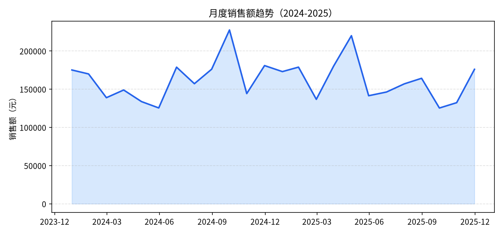
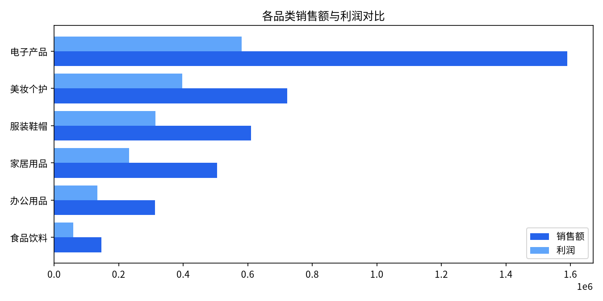
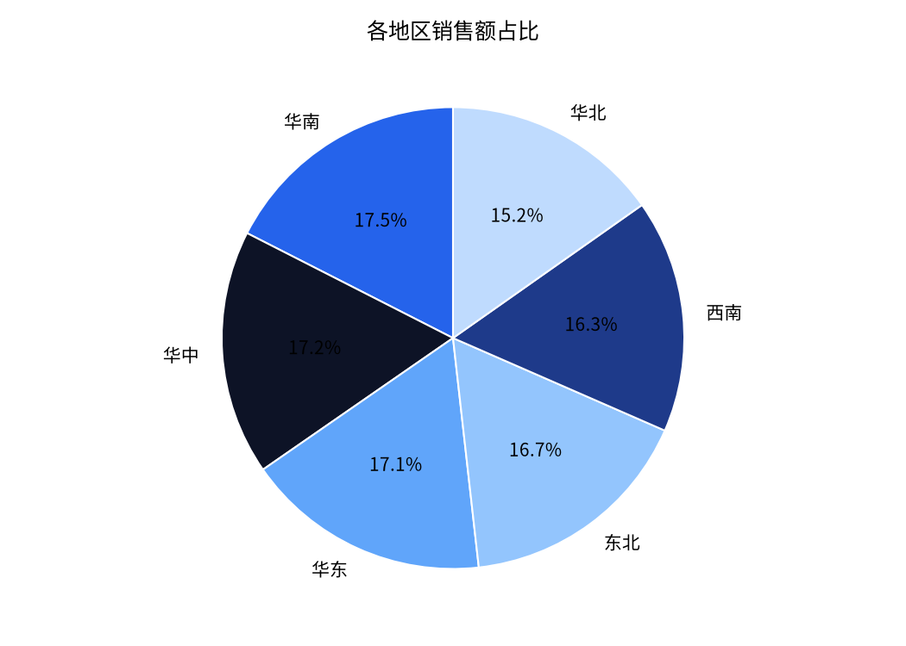
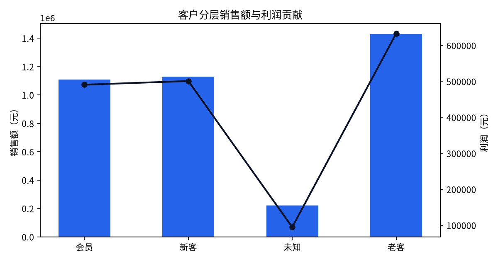

# 2024—2025 区域零售销售数据分析报告（课堂样例）

> 数据时间范围：2024-01-01 至 2025-12-31
> 数据来源：`data/retail_sales_raw.csv`（教学合成数据），经多智能体流水线清洗、分析与质检后生成
> 生成方式：Trae 数据工程 / 分析 Agent + WorkBuddy 报告 Agent 协作完成
> 说明：本报告为课堂参考样例，数字均来自 `outputs/summary_metrics.json`；结论区分数据事实、分析判断与待验证假设。

## 一、执行摘要

1. 两年共形成有效订单 **3388 笔**，累计销售额 **3,888,210.60 元**，累计利润 **1,719,269.64 元**，整体利润率 **44.22%**，客单价 **1,147.64 元**。
2. **电子产品**是规模第一品类，销售额占比 **40.9%**，但其利润率 **36.6%** 低于整体水平；**美妆个护**利润率最高，为 **55.0%**。
3. 六大区销售额分布相对均衡，华南、华中、华东位列前三；各区利润率集中在 43.6%—45.0%，地区间盈利效率差异不大。
4. **老客**贡献销售额 **36.8%**，为第一客户群体；新客与会员分别贡献 29.1% 与 28.5%；另有 163 笔订单客户分层缺失（标记为「未知」），需要补全标签。
5. 两年总销售额基本持平（2024 年约 195.7 万元，2025 年约 193.1 万元），增长动能不足，后续需结合更多经营数据验证原因。

## 二、整体经营概况

| 指标 | 数值 | 口径说明 |
|---|---|---|
| 有效订单数 | 3388 笔 | 清洗后剔除重复、异常数量、负利润与缺失日期记录 |
| 总销售额 | 3,888,210.60 元 | quantity × unit_price × (1 − discount) 复核口径 |
| 总利润 | 1,719,269.64 元 | 销售额 − 成本 |
| 整体利润率 | 44.22% | 总利润 / 总销售额 |
| 客单价 | 1,147.64 元 | 总销售额 / 有效订单数 |
| 件单价均值 | 285.35 元 | 全部订单 unit_price 平均值 |

> 数据事实：以上指标可由 `data/retail_sales_cleaned.csv` 复算；清洗过程与剔除条数见 `outputs/cleaning_report.json`，质检结论见 `outputs/qa_review.md`。

## 三、销售趋势分析

- 数据事实：月度销售额峰值出现在 **2024 年 10 月**（约 22.75 万元），低谷出现在 **2025 年 10 月**（约 12.54 万元）。
- 数据事实：年度对比，2024 年销售额约 1,956,839.15 元，2025 年约 1,931,371.45 元，同比小幅下降约 1.3%。
- 分析判断：样本期内未观察到持续上升趋势，月度波动较大；仅凭本订单数据无法判断波动来自季节因素、促销节奏还是客流变化。
- 待验证假设：需要补充客流、营销投放、库存与外部环境数据后，才能确认波动原因。

## 四、品类分析

| 品类 | 订单数 | 销售额（元） | 销售占比 | 利润（元） | 利润率 | 客单价（元） |
|---|---:|---:|---:|---:|---:|---:|
| 电子产品 | 574 | 1,590,277.86 | 40.9% | 581,423.57 | 36.6% | 2771 |
| 美妆个护 | 547 | 722,924.65 | 18.6% | 397,462.75 | 55.0% | 1322 |
| 服装鞋帽 | 566 | 610,761.72 | 15.7% | 314,199.98 | 51.4% | 1079 |
| 家居用品 | 574 | 504,506.27 | 13.0% | 232,845.72 | 46.2% | 879 |
| 办公用品 | 586 | 312,842.31 | 8.0% | 133,820.51 | 42.8% | 534 |
| 食品饮料 | 541 | 146,897.79 | 3.8% | 59,517.11 | 40.5% | 272 |

- 数据事实：电子产品以最高客单价（2771 元）拉动规模，但利润率为六类最低；美妆个护与服装鞋帽利润率处于较高水平。
- 分析判断：品类结构呈现「电子产品走量、高毛利品类贡献利润」的特征；规模与盈利效率并不一致。
- 待验证假设：电子产品利润率偏低是否由价格竞争、采购成本或促销折扣导致，需要结合成本明细与促销记录进一步分析。

## 五、地区分析

| 地区 | 订单数 | 销售额（元） | 销售占比 | 利润率 |
|---|---:|---:|---:|---:|
| 华南 | 589 | 680,040.38 | 17.5% | 44.2% |
| 华中 | 574 | 667,246.03 | 17.2% | 44.3% |
| 华东 | 565 | 666,043.42 | 17.1% | 44.1% |
| 东北 | 546 | 647,548.69 | 16.7% | 43.6% |
| 西南 | 573 | 635,345.82 | 16.3% | 45.0% |
| 华北 | 541 | 591,986.26 | 15.2% | 44.1% |

- 数据事实：六个地区销售额占比在 15.2%—17.5% 之间，差距较小；西南利润率略高，东北略低。
- 分析判断：区域发展相对均衡，不存在明显弱势区域；地区层面的经营策略差异不是当前利润率分化的主要来源。

## 六、客户分层分析

| 客户分层 | 订单数 | 销售额（元） | 销售占比 | 利润率 | 客单价（元） |
|---|---:|---:|---:|---:|---:|
| 老客 | 1281 | 1,429,699.65 | 36.8% | 44.3% | 1116 |
| 新客 | 996 | 1,129,642.36 | 29.1% | 44.3% | 1134 |
| 会员 | 948 | 1,108,248.24 | 28.5% | 44.3% | 1169 |
| 未知 | 163 | 220,620.35 | 5.7% | 42.9% | 1353 |

- 数据事实：老客订单数与销售额占比均为最高；会员客单价略高于新客与老客；「未知」分层订单利润率略低。
- 分析判断：存量老客是当前收入基本盘；会员与新客规模接近，会员价值提升空间需要结合复购数据评估。
- 待改进：163 笔缺失客户分层的订单应在业务系统中补全标签，避免分析被归入未知群体。

## 七、问题与风险

1. **增长停滞风险**：两年销售额基本持平，缺少增长证据；需补充客流、复购与营销数据判断是趋势性问题还是样本波动。
2. **品类盈利结构风险**：规模最大的电子产品利润率最低，一旦价格竞争加剧，对整体利润的冲击会被放大。
3. **数据质量风险**：原始数据存在重复、缺失、异常金额与日期格式问题；若未经过独立质检直接分析，可能产生错误结论。
4. **客户标签缺口**：未知分层订单占比 5.7%，影响客户结构分析的准确性。
5. **因果解释不足**：本报告仅基于订单交易数据，不能单独支撑渠道、定价或营销决策。

## 八、行动建议（对应前文发现）

1. **优先验证电子产品成本结构**：调取采购成本、折扣与促销记录，定位利润率偏低的具体环节（待数据补充后执行）。
2. **提升高毛利品类占比**：在门店陈列、组合推荐中加强美妆个护、服装鞋帽的引导，验证对整体利润率的改善效果。
3. **强化老客维护与会员转化**：基于老客与会员消费结构设计复购与会员权益方案，持续跟踪客单价变化。
4. **补全客户标签体系**：在下单与售后环节完善分层字段，消除「未知」类别。
5. **建立常态化多智能体分析流水线**：将清洗、分析、质检、报告流程固化，每次经营复盘保留 AgentOps 轨迹，便于对比与追责。

## 九、附录

### 9.1 数据口径

- 销售额 = quantity × unit_price × (1 − discount)，清洗阶段统一复核；
- 利润率 = 利润 / 销售额；客单价 = 销售额 / 订单数；
- 缺失客户分层回填为「未知」，不计入新客 / 老客 / 会员；
- 负利润、数量非正、重复记录、缺失日期记录在清洗阶段剔除，明细见清洗报告。

### 9.2 产物清单

- 清洗后数据：`data/retail_sales_cleaned.csv`
- 清洗报告：`outputs/cleaning_report.json`
- 指标文件：`outputs/summary_metrics.json`
- 图表：`outputs/charts/01_monthly_sales.png` 至 `04_segment_contribution.png`
- 质检报告：`outputs/qa_review.md`

### 9.3 质检说明

本报告所有指标与图表均以质检 Agent 通过后的产物为准；质检退回环节的修复记录见 AgentOps 轨迹表。报告中的「待验证假设」需补充其他数据源后再形成经营决策。
